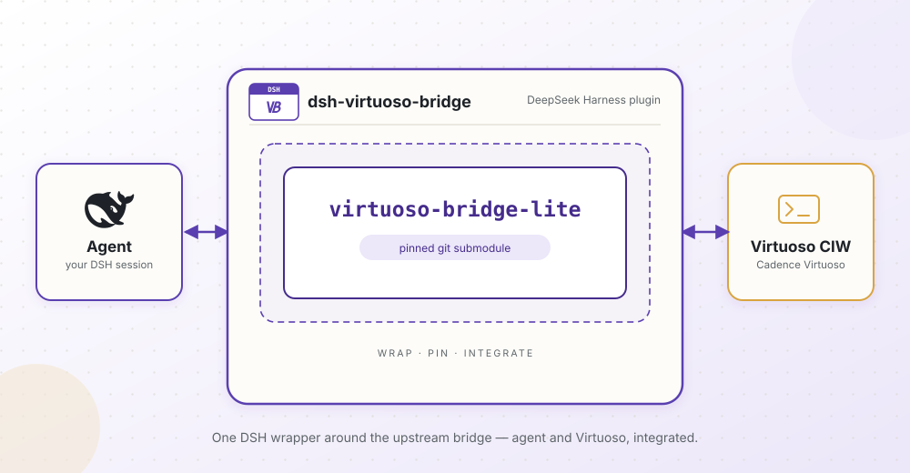

<p align="center">
  
</p>

<h3 align="center">
  <a href="https://nekomona.github.io/dsh-virtuoso-bridge/">▶ <strong>Read the guide</strong></a>
</h3>

<p align="center">
  <a href="README.md"><b>English</b></a> &nbsp;·&nbsp; <a href="README.zh-CN.md">简体中文</a>
</p>

<p align="center">
  <a href="LICENSE"></a>
  <a href="https://www.npmjs.com/package/@nekomona/dsh-virtuoso-bridge"></a>
  <a href="https://github.com/nekomona/dsh-virtuoso-bridge"></a>
</p>

**`dsh-virtuoso-bridge`** is a DeepSeek Harness plugin built around
[**Virtuoso Bridge**](https://github.com/Arcadia-1/virtuoso-bridge-lite), the
upstream tool that connects an agent to a **Cadence Virtuoso** CIW. The upstream
bridge owns the SSH tunnel, the daemon and the Python API; this plugin owns what
is left to the user:

* **One-click deployment** — pick a source and press **Install**: the plugin
  creates the isolated venv, installs the pinned bridge, verifies the import, and
  prepares and uploads the CIW daemon setup, leaving only the single
  `load("...")` line that has to run in the CIW.
* **Multi-session interop** — runtimes are process-wide, so every conversation,
  fork and subagent in the profile shares one tunnel and one daemon. Automatic
  sessions and workdir sub-instances are discovered and selected for you, and
  the right sidebar shows which session is attached to which runtime.
* **Agent-ready surfaces** — the whole bridge API as one tool, batched Python in
  the same venv, and CIW warnings attached to every result.

## The tools

| Tool | What the agent does with it |
| --- | --- |
| `virtuoso_bridge_runtime` | Saves connections, discovers daemons, trusts host keys, starts and stops the managed tunnel, deploys the CIW setup |
| `virtuoso_bridge_api` | Describes and calls any Python object: schematics, layouts, libraries, symbols, Maestro, Spectre |
| `virtuoso_bridge_script` | Runs batched Python in the isolated venv, inline or from a workspace file |
| `virtuoso_bridge_setup` | Installs, repairs and diagnoses that venv from the bundled, local or git source, and manages caches |

Everything else is DSH UI: a **Virtuoso Bridge** configuration page in the left
sidebar, and a **Bridge runtime** panel on the right showing connections,
daemons and agent activity.

## Quick start

```text
Install the DSH bundle `@nekomona/dsh-virtuoso-bridge`.
```

Then open the **Virtuoso Bridge** configuration page in the left sidebar, press
**Install**, add a server connection and press **Start**. The first CIW needs the
printed `load("...")` line once; after that the runtime reports `running` on its
own.

## Documentation

* [Getting started](https://nekomona.github.io/dsh-virtuoso-bridge/getting-started.html) — install, first setup, a first running daemon
* [Connections](https://nekomona.github.io/dsh-virtuoso-bridge/connections.html) — fixed ports, automatic sessions, host keys, credentials, deployment
* [Agent tools](https://nekomona.github.io/dsh-virtuoso-bridge/agent-tools.html) — every action and argument
* [Workflows](https://nekomona.github.io/dsh-virtuoso-bridge/workflows.html) — Maestro jobs, dialogs, history, CIW diagnostics
* [Runtime](https://nekomona.github.io/dsh-virtuoso-bridge/runtime.html) — states, the Host-owned tunnel, panels, isolation, caches
* [Troubleshooting](https://nekomona.github.io/dsh-virtuoso-bridge/troubleshooting.html) — triage, trust, dialogs, limits

The published guide is bilingual; every chapter also has a `.zh-CN.html` twin. For
offline reading, [`docs/plugin-guide.md`](docs/plugin-guide.md) carries the same
material with architecture, development and limitation notes.

## Thanks

Built on [Virtuoso Bridge](https://github.com/Arcadia-1/virtuoso-bridge-lite)
(`virtuoso-bridge-lite`), which does the SSH, daemon and SKILL work; this
repository is only its DeepSeek Harness wrapper. It is pinned as the
`virtuoso-bridge-lite/` git submodule and recorded with its commit, date and
license in [`virtuoso-bridge-lite.pin.json`](virtuoso-bridge-lite.pin.json).
Both projects are MIT licensed. Cadence and Virtuoso are trademarks of Cadence
Design Systems, Inc.; this plugin is not affiliated with Cadence.
