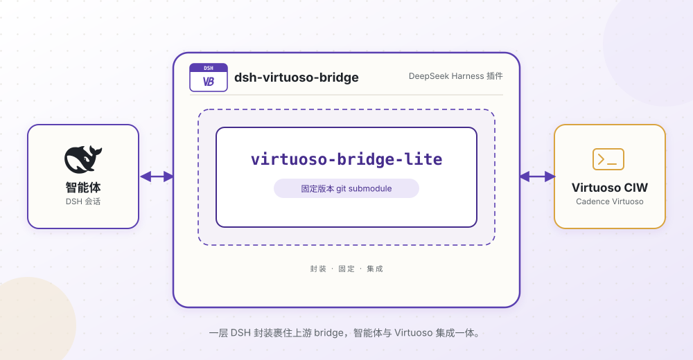

<p align="center">
  
</p>

<h3 align="center">
  <a href="https://nekomona.github.io/dsh-virtuoso-bridge/index.zh-CN.html">▶ <strong>看文档</strong></a>
</h3>

<p align="center">
  <a href="README.md">English</a> &nbsp;·&nbsp; <a href="README.zh-CN.md"><b>简体中文</b></a>
</p>

<p align="center">
  <a href="LICENSE"></a>
  <a href="https://www.npmjs.com/package/@nekomona/dsh-virtuoso-bridge"></a>
  <a href="https://github.com/nekomona/dsh-virtuoso-bridge"></a>
</p>

**`dsh-virtuoso-bridge`** 是围绕上游
[**Virtuoso Bridge**](https://github.com/Arcadia-1/virtuoso-bridge-lite) 的
DeepSeek Harness 插件：后者负责把智能体接入 **Cadence Virtuoso** 的 CIW。SSH 隧道、
守护进程和 Python API 都来自上游；本插件负责补上留给用户的那部分：

* **一键部署** —— 选好来源、点 **Install**：插件创建隔离 venv、安装固定版本的
  bridge、验证导入，再准备并上传 CIW 守护进程 setup，最后只剩一行 `load("...")`
  需要在 CIW 里执行。
* **多会话互通** —— 运行时是进程级的，同一 profile 里的对话、fork 和子智能体共用
  一套隧道和一个守护进程。自动会话与工作目录子实例由插件发现并选中，右侧面板显示
  哪个会话挂在哪个运行时上。
* **面向智能体的接口** —— 整套 bridge API 作为一个工具、同一个 venv 里的批量
  Python，以及随每次结果返回的 CIW 警告。

## 工具一览

| 工具 | 智能体用它做什么 |
| --- | --- |
| `virtuoso_bridge_runtime` | 保存连接、发现守护进程、信任主机密钥、启停托管隧道、部署 CIW setup |
| `virtuoso_bridge_api` | 描述并调用任意 Python 对象：schematic、layout、library、symbol、Maestro、Spectre |
| `virtuoso_bridge_script` | 在隔离 venv 中批量运行 Python，可内联代码或指向工作区文件 |
| `virtuoso_bridge_setup` | 从内置、本地或 git 源安装、修复并诊断该 venv，管理缓存 |

界面部分：左侧的 **Virtuoso Bridge 配置**页，以及右侧显示连接、守护进程和智能体
活动的 **Bridge runtime** 面板。

## 快速开始

```text
Install the DSH bundle `@nekomona/dsh-virtuoso-bridge`.
```

然后打开左侧的 **Virtuoso Bridge 配置**页，点 **Install**，添加一条服务器连接并点
**Start**。首次使用的 CIW 需要执行一次面板给出的 `load("...")`，之后运行时会自动
变为 `running`。

## 深入阅读

* [开始使用](https://nekomona.github.io/dsh-virtuoso-bridge/getting-started.zh-CN.html) — 安装、首次配置、第一个运行中的守护进程
* [连接](https://nekomona.github.io/dsh-virtuoso-bridge/connections.zh-CN.html) — 固定端口、自动会话、主机密钥、凭据、部署
* [智能体工具](https://nekomona.github.io/dsh-virtuoso-bridge/agent-tools.zh-CN.html) — 每个动作和参数
* [工作流](https://nekomona.github.io/dsh-virtuoso-bridge/workflows.zh-CN.html) — Maestro 作业、对话框、历史、CIW 诊断
* [运行时](https://nekomona.github.io/dsh-virtuoso-bridge/runtime.zh-CN.html) — 状态、Host 托管隧道、面板、隔离、缓存
* [故障排查](https://nekomona.github.io/dsh-virtuoso-bridge/troubleshooting.zh-CN.html) — 分诊、信任、对话框、限制

站点为双语，每章都有对应的 `.zh-CN.html`。离线阅读见
[`docs/plugin-guide.zh-CN.md`](docs/plugin-guide.zh-CN.md)，其中包含架构、开发和限制说明。

## 致谢

基于上游 [Virtuoso Bridge](https://github.com/Arcadia-1/virtuoso-bridge-lite)
（`virtuoso-bridge-lite`）开发：SSH、守护进程和 SKILL 侧的工作都由它完成，本仓库只是
它的 DeepSeek Harness 封装。上游以 `virtuoso-bridge-lite/` git submodule 固定版本，
其提交、日期与许可记录在
[`virtuoso-bridge-lite.pin.json`](virtuoso-bridge-lite.pin.json)。两个项目均为 MIT 许可。
Cadence 与 Virtuoso 是 Cadence Design Systems, Inc. 的商标；本插件与 Cadence 无关。
